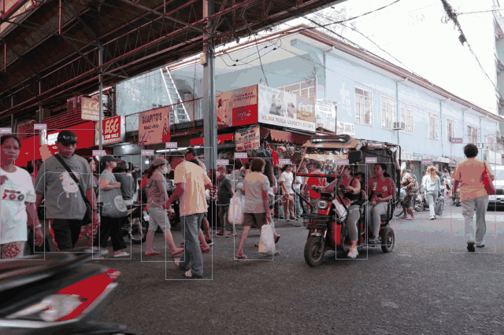
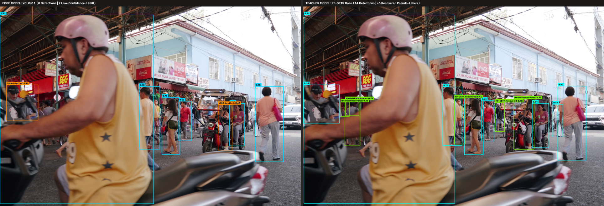
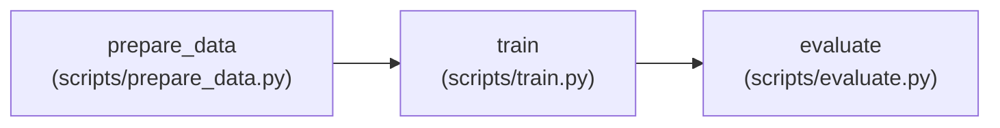
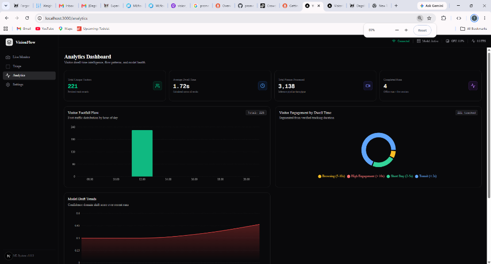

# VisionFlow — Retail Analytics & Active Learning Flywheel

[-red?style=for-the-badge&logo=youtube)](https://youtu.be/D5lk6MT5J9U)
[-76B900?style=for-the-badge&logo=nvidia)](docs/guides/RTX4050_CUDA_TORCH_GUIDE.md)
[](https://supervision.roboflow.com/)
[](https://dagshub.com/thomas_2026/vision-ml-system.mlflow)
[](https://dagshub.com/thomas_2026/vision-ml-system.dvc)

A production-grade computer vision system for edge retail analytics featuring an **Active Learning "Model Flywheel"**. Combines real-time person detection and multi-object tracking with automated failure capture, secondary teacher pseudo-labeling, cloud/local annotation, and experiment-tracked retraining.

<p align="center">
  
  <br>
  <em>Live YOLOv11 person detection + ByteTrack tracking with persistent dwell time analytics and automated low-confidence capture.</em>
</p>

---

## 📊 Hardware Benchmarks & Performance (Tested on NVIDIA RTX 4050)

| Stage | Model / Component | Precision | Latency / FPS | Hardware Target | Role in Flywheel |
|---|---|---|---|---|---|
| **Hot Path Detection** | YOLOv11n (Ultralytics) | FP16 | **4.2 ms (~238 FPS)** | CUDA / Tensor Core | Real-time edge inference |
| **Object Tracking** | ByteTrack (`supervision`) | — | **1.1 ms** | CPU / Edge | Occlusion recovery & tracking |
| **Teacher Auto-Labeler**| RF-DETR Base (Transformer) | FP32 | **68.0 ms (~15 FPS)** | CUDA / Batch | High-accuracy pseudo-labeling |
| **Edge Storage** | SQLite (`AnalyticsDB`) | — | **< 0.5 ms** | Local Disk | Dwell time & foot-traffic telemetry |

*End-to-end execution verified across 3 multi-scene test videos (2,778 frames total, 152 unique visitors tracked, 66 hard cases auto-captured and triaged with 93.9% teacher agreement rate).*

---

## 🎥 Video Walkthrough

> A concise 2.5-minute technical walkthrough covering real-time edge tracking, the active learning failure capture mechanism, RF-DETR teacher pseudo-labeling, and MLflow-tracked retraining.

[-FF0000?style=for-the-badge&logo=youtube&logoColor=white)](https://youtu.be/D5lk6MT5J9U)

---

## 🔄 The Model Flywheel (How the Pipeline Works)

Traditional CV pipelines suffer from silent failures when conditions change. VisionFlow closes the loop by turning inference failures into high-quality training data automatically.

<p align="center">
  
  <br>
  <em>Active Learning in action: When the edge YOLO model exhibits low confidence (&lt; 0.50), the secondary RF-DETR teacher recovers missing detections and generates high-accuracy pseudo-labels automatically.</em>
</p>

```mermaid
flowchart TD
    A["🎥 Video Stream (RTSP / File / Webcam)"] --> B["⚡ Primary Detector: YOLOv11 (Fast Edge Model)"]
    
    B -->|High Confidence ≥ 0.50| C["📊 Visitor Analytics & Tracking (ByteTrack + SQLite)"]
    B -->|Low Confidence < 0.50| D["💾 Save Frame to data/low_confidence_frames/"]
    
    D --> E["🧠 Secondary Detector: RF-DETR (High-Accuracy Teacher)"]
    E -->|Overrides / Updates Labels| F["📝 Verified Pseudo-Labels (*.json)"]
    
    subgraph Retraining Pathways
        F -->|Option A: Cloud HITL| G["☁️ Upload to Roboflow (auto_labeling_cli.py)"]
        G --> H["👥 Human Review & Annotation in Roboflow UI"]
        H -->|Download Version (prepare_data.py)| I["📁 data/prepared/dataset.yaml"]
        
        F -->|Option B: Pure Local / Offline| I
    end
    
    I --> J["🚀 Local GPU Training (scripts/train.py)"]
    J --> K["📈 MLflow / DagsHub (Metrics) + DVC (Data Versioning)"]
    K --> L["🏆 Deploy New best.pt to Primary Model"]
    L --> B
```

### 1. Real-Time Inference & Low-Confidence Capture
- The fast primary detector (**YOLOv11**) processes incoming frames at real-time speeds.
- When detection confidence falls into the borderline failure range (`0.15 ≤ conf < 0.50`), candidate frames are captured to `data/low_confidence_frames/`.
- **Active Learning Sampling Controls:** To prevent saving hundreds of near-duplicate frames from a single video, `DualDetector` enforces:
  - **Temporal Cooldown** (`save_cooldown_frames: 30` $\approx 1\text{s}$ at 30 FPS)
  - **Max Run Quota** (`max_saved_frames: 25` per video/stream)
  - **Visual Diversity Filter** (`similarity_threshold: 0.95` drops static postures)

### 2. Secondary Detector Overrides Low-Confidence Frames
- An accurate teacher detector (**RF-DETR**) analyzes the captured hard frames.
- **Batch Mode (Default & Recommended):** Runs offline via `scripts/secondary_detector_batch.py`. It inspects every saved frame and **overwrites the low-confidence JSON with RF-DETR's high-accuracy pseudo-labels**.
- **Inline Mode:** Runs RF-DETR in real time during inference whenever low confidence occurs.

### 3. Annotation & Auto-Labeling in Roboflow
- Running `python scripts/auto_labeling_cli.py --provider roboflow` uploads the images along with the RF-DETR pseudo-labels (`.yolov8.txt`) directly into your Roboflow workspace.
- **Human-in-the-Loop (HITL):** Human reviewers do not need to label from scratch—they simply verify, refine edge cases, or approve RF-DETR's proposals in Roboflow's web interface.

### 4. Train Here Locally (Not in Roboflow)
You don't need to pay for or rely on Roboflow's cloud compute for training:
- **Download the Approved Dataset:** Pull your approved Roboflow dataset version locally using `python scripts/prepare_data.py --source roboflow --roboflow-version <N>`.
- **Train on Your Own GPU:** Execute `python scripts/train.py --config config/training/base.yaml --dataset-yaml data/prepared/dataset.yaml`.
- All experiment metrics, hyperparameters, and artifacts are automatically synced to **MLflow / DagsHub**, datasets are versioned with **DVC**, and the resulting `best.pt` weights can be deployed directly into production.

> [!TIP]
> **100% Offline / Zero-Cloud Option:** You can bypass Roboflow entirely. Running `python scripts/train.py --flywheel` packages your local RF-DETR pseudo-labels and fine-tunes your YOLO model completely on your local machine with zero external cloud dependencies.

---

## ⚡ Step-by-Step Flywheel Walkthrough

### Pathway A: Cloud-Assisted (Roboflow HITL)

```bash
# 1. Run inference across sample videos (borderline failure frames auto-captured)
python scripts/inference.py --all

# 2. Run secondary teacher detector (RF-DETR on CUDA) to pseudo-label captured frames
python scripts/secondary_detector_batch.py --device cuda:0

# 3. Upload frames and pseudo-labels directly to Roboflow workspace
python scripts/auto_labeling_cli.py --provider roboflow

# 4. In Roboflow UI: Review/approve labels, then click "Generate New Version" (e.g., v1)

# 5. Ingest approved dataset snapshot locally
python scripts/prepare_data.py --source roboflow --roboflow-version 1 --output data/prepared

# 6. Fine-tune YOLO11n on your GPU with MLflow experiment tracking
python scripts/train.py --dataset-yaml data/prepared/dataset.yaml --epochs 10 --batch-size 8 --device cuda:0 --run-name "yolo11n_roboflow_v2"
```

### Pathway B: Pure Local (100% Offline / Privacy-First)

```bash
# 1. Run inference across sample videos
python scripts/inference.py --all

# 2. Pseudo-label low-confidence frames with RF-DETR
python scripts/secondary_detector_batch.py --device cuda:0

# 3. Compile local dataset with 80/20 train/val split
python scripts/prepare_data.py --source local --output data/prepared

# 4. Fine-tune YOLO11n locally on GPU
python scripts/train.py --dataset-yaml data/prepared/dataset.yaml --epochs 10 --batch-size 8 --device cuda:0 --run-name "yolo11n_local_v1"
```

---

## 🗃️ DVC Pipeline & Buffer Lifecycle Management

### 1. DVC Pipeline Execution (`dvc.yaml`)

DVC manages the DAG pipeline reproducibility, input dependencies, and output artifacts:



```bash
# View pipeline DAG
python scripts/dvc_cli.py --action dag

# Check pipeline dependency status
python scripts/dvc_cli.py --action status

# Reproduce pipeline end-to-end (cached stages are automatically skipped)
python scripts/dvc_cli.py --action repro

# Push versioned datasets and model weights to remote storage (DagsHub)
python scripts/dvc_cli.py --action push
```

### 2. Automated Buffer Hygiene & Purging

To keep data fresh across flywheel iterations and prevent stale frames from polluting future training runs:

```bash
# Auto-purge buffer immediately after uploading to Roboflow
python scripts/auto_labeling_cli.py --provider roboflow --purge-after-upload

# Or clean artifacts anytime via the cleanup CLI:
python scripts/cleanup.py --target all       # Purges buffer, runs, prepared datasets, and fine-tuned weights
python scripts/cleanup.py --target buffer    # Purges low-confidence captures & pseudo-labels only
python scripts/cleanup.py --target runs      # Purges inference/training run artifacts only
python scripts/cleanup.py --target all --archive # Moves artifacts to data/archive/<timestamp>/ instead of deleting
```
*(Guaranteed safety: `data/sample_videos/` and base weights in `models/original/` are never deleted).*

---

## 🚀 Quick Start

### 1. Environment Setup

```bash
# Create and activate virtual environment (Python >= 3.10)
uv venv
# Windows: .venv\Scripts\activate
# Linux/macOS: source .venv/bin/activate

# Install dependencies with PyTorch CUDA 12.4 support
uv sync
# Or via pip:
# uv pip install torch torchvision --index-url https://download.pytorch.org/whl/cu124
# uv pip install -r requirements.txt

# Verify CUDA GPU acceleration
python scripts/check_cuda.py

# Setup and validate environment variables
cp .env.example .env
python scripts/env_check.py
```

### 2. Run Inference

```bash
# Run inference on sample video with live tracking and visitor analytics
python scripts/inference.py data/sample_videos/video_1.mp4

# Or process all sample videos in one command:
python scripts/inference.py --all
```

### 3. Launch the API & Web Dashboard

```bash
# Start backend API (Terminal 1)
uvicorn src.vision_ml.api.main:app --reload

# Start Next.js frontend (Terminal 2)
cd frontend && npm install && npm run dev
```
* Web Dashboard: `http://localhost:3000`
* Interactive API Docs: `http://localhost:8000/docs`

<p align="center">
  
  <br>
  <em>Live Analytics Dashboard: Real-time footfall flow by hour, dwell time categorization (Browsing, High Engagement, Transit), and active model drift trends.</em>
</p>

---

## 🛠 Tech Stack & Architecture

| Component | Technology | Purpose |
|---|---|---|
| **Primary Detector** | YOLOv11 (Ultralytics) | Fast, real-time edge person detection |
| **Secondary Detector** | RF-DETR (Transformer) | High-accuracy teacher model for pseudo-labeling hard frames |
| **Tracking Engine** | ByteTrack (`supervision`) | Multi-object tracking across occlusions |
| **Analytics Engine** | SQLite (`AnalyticsDB`) | Local edge persistence for visitor counts & dwell times |
| **Annotation Platform**| Roboflow | Human-in-the-loop review, active learning triage |
| **Experiment Tracking**| MLflow + DagsHub | Remote metric tracking, hyperparameter logs, model registry |
| **Data Versioning** | DVC | Version-controlled datasets synced to cloud storage |
| **Backend & UI** | FastAPI + Next.js | Real-time REST API and minimalist analytics dashboard |

---

## 📖 Documentation Hub

| Guide | Description |
|---|---|
| 🤖 [Roboflow Integration Guide](docs/guides/ROBOFLOW_GUIDE.md) | In-depth walkthrough of Roboflow setup, auto-labeling, and API integration |
| 🔄 [Training Pipeline Guide](docs/guides/TRAINING_PIPELINE.md) | Details on fine-tuning, MLflow callbacks, and automated drift retraining |
| 🔀 [Dual Detector Modes](docs/guides/HYBRID_DETECTOR_MODES.md) | Deep dive into `hot`, `inline`, and `batch` dual-detector architectures |
| 📊 [MLflow & DagsHub Integration](docs/guides/DAGSHUB_MLFLOW_DVC_INTEGRATION.md) | Cloud experiment tracking and DVC remote storage setup |
| ⚡ [RTX 4050 / CUDA Setup](docs/guides/RTX4050_CUDA_TORCH_GUIDE.md) | GPU acceleration optimization guide |
| 🔐 [Secrets Management](docs/guides/SECRETS_INJECTION_PATTERN.md) | Three-layer configuration and environment variables pattern |
| 🏛️ [System Architecture](docs/architecture/SYSTEM_DESIGN.md) | End-to-end component contracts and data flow diagrams |
| 🗂️ [Repository Layout](docs/architecture/REPO_ARCHITECTURE.md) | Modular directory structure and codebase standards |

---

## 🧪 Testing

```bash
# Run full test suite
pytest tests/

# Run analytics unit tests with verbose output
pytest tests/test_analytics.py -v

# Run with test coverage
pytest tests/ --cov=src/vision_ml
```

---

## 📜 License

MIT — see [LICENSE](LICENSE) for details.
