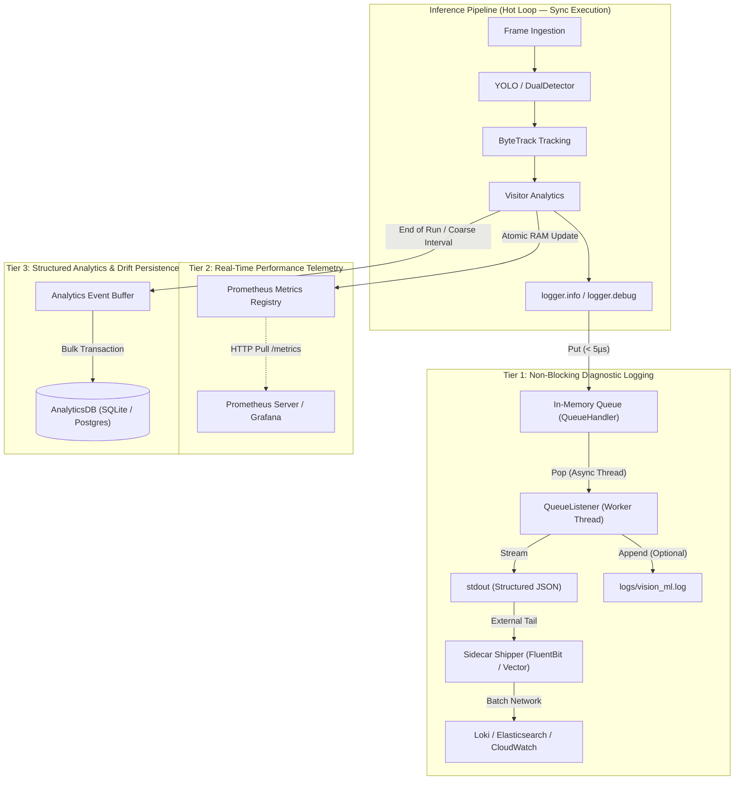

# SPEC: High-Throughput, Low-Latency Logging & Telemetry Architecture

> **Document Status:** Approved / Production Specification  
> **Target Version:** 1.0.0  
> **Domain:** Vision ML System — Real-Time Inference & Edge Analytics  
> **Authors:** Jules (Senior ML Systems Engineer)  
> **Scope:** `src/vision_ml/logging`, `src/vision_ml/inference`, `src/vision_ml/api`, `src/vision_ml/analytics`

---

## 1. Executive Summary & Design Philosophy

In real-time computer vision pipelines processing 30 to 60+ FPS, the frame time budget is strictly bounded between **16.6ms (60 FPS)** and **33.3ms (30 FPS)**. Under this regime, the primary computational budget must be allocated exclusively to model forward passes (YOLOv11 / RF-DETR), post-processing, and multi-object tracking (ByteTrack).

### Core Problem
Conventional application logging (writing synchronously to disk or invoking direct database transactions per log entry) introduces variable I/O latency, locks, and network jitter that degrades throughput, dropping frame rates from 30+ FPS down to 5–10 FPS.

### Architectural Bets
1. **Zero Hot-Path I/O:** The inference thread must never execute synchronous disk writes, database queries, or network HTTP calls for logging.
2. **Three-Tier Separation of Concerns:**
   - **Tier 1 (Operational Logs):** Non-blocking in-memory queue (`QueueHandler`) flushes to stdout/disk via an independent background thread (`QueueListener`).
   - **Tier 2 (High-Frequency Telemetry):** In-memory atomic counters and gauges scraped asynchronously via Prometheus (`/metrics`).
   - **Tier 3 (Structured Analytics & Drift):** Coarse-grained session events batched asynchronously to `AnalyticsDB` (SQLite/PostgreSQL).
3. **Privacy-First & Edge-Deployable:** Operates with 100% functionality locally without cloud dependencies, but provides standardized log-shipper integration hooks (FluentBit/Vector) for cloud scale.

---

## 2. Latency Budget & Performance Constraints

| Pipeline Stage | Target Latency Budget (30 FPS) | Worst-Case Bound | Failure Policy |
| :--- | :--- | :--- | :--- |
| **Frame Ingestion** | 1.0 – 2.0 ms | 5.0 ms | Drop frame if buffer exceeds capacity |
| **Detector (YOLOv11n)** | 10.0 – 18.0 ms | 25.0 ms | Circuit breaker trips after 3 failures |
| **Tracker (ByteTrack)** | 1.5 – 3.0 ms | 6.0 ms | Reset track state if corrupt |
| **Analytics Processing** | 0.5 – 1.0 ms | 2.0 ms | Memory-only aggregation |
| **Logging Hot-Path** | **< 0.05 ms (< 50 µs)** | **0.1 ms** | **Drop log record if queue full (non-blocking)** |
| **Total Frame Latency** | **~15.0 – 25.0 ms** | **33.3 ms** | Zero dropped frames under nominal load |

---

## 3. The 3-Tier Logging & Telemetry Architecture



---

## 4. Component Technical Specifications

### Tier 1: Operational Logging (`src/vision_ml/logging`)

#### 4.1 Interface Contract
Every subsystem must access logging strictly through the standard interface:
```python
from ..logging import get_logger

logger = get_logger(__name__)
```

#### 4.2 Queue Management & Threading Model
- **Main Thread:** Interacts solely with `logging.handlers.QueueHandler(queue.Queue(maxsize=10000))`. The call `queue.put_nowait(record)` executes in under 5 microseconds without acquiring file or socket locks.
- **Background Listener Thread:** Managed by `logging.handlers.QueueListener`. Consumes records in FIFO order and dispatches them to destination handlers (`StreamHandler`, `RotatingFileHandler`).
- **Overflow & Backpressure Strategy:** If `maxsize` is reached (e.g., during sudden disk degradation), the queue must drop `DEBUG` and `INFO` records, increment an internal dropped-log counter, and log an `OVERFLOW_WARNING` without blocking inference.

#### 4.3 Formats & Serialization
- **Development / Interactive Mode:** Human-readable pipe-delimited format:
  `YYYY-MM-DD HH:MM:SS | LEVEL    | module.name | Message text`
- **Production / Container Mode:** Structured single-line JSON format adhering to [`log_schema.json`](file:///d:/01_WORK/Career/Portfolio%20Projects/vision-ml-system/specs/logging_best_practice/log_schema.json) for zero-parsing-overhead indexing in Grafana Loki or Elasticsearch.

---

### Tier 2: Real-Time Telemetry & Prometheus (`src/vision_ml/api`)

Telemetry metrics are purely quantitative measurements of pipeline health. They are never written to text log streams.

#### 4.1 Standard Metrics Specification
| Metric Name | Type | Labels | Description |
| :--- | :--- | :--- | :--- |
| `vision_inference_latency_seconds` | Histogram | `detector`, `device` | Inference duration distribution (buckets: 5ms to 100ms) |
| `vision_pipeline_fps` | Gauge | `source_id`, `mode` | Instantaneous processed frames per second |
| `vision_active_tracks_count` | Gauge | `camera_id` | Current unique active visitor tracks in scene |
| `vision_drift_score` | Gauge | `model_version` | Rolling drift score (confidence drop metric) |
| `vision_circuit_breaker_state` | Gauge | `stage` | Circuit breaker status (0=Closed/Normal, 1=Half-Open, 2=Open/Bypassed) |

#### 4.2 Scraping Protocol
Metrics are stored in shared process memory and exposed via FastAPI endpoint `/metrics` utilizing Prometheus pull model. Prometheus server scrapes every 5–15 seconds, introducing zero overhead on frame execution.

---

### Tier 3: Business Analytics & MLOps Persistence (`src/vision_ml/analytics`)

#### 4.1 Database Separation
`AnalyticsDB` ([`analytics_db.py`](file:///d:/01_WORK/Career/Portfolio%20Projects/vision-ml-system/src/vision_ml/analytics/analytics_db.py)) is reserved exclusively for high-value business intelligence:
- Completed visitor sessions (dwell time, first/last frame, entry/exit timestamp).
- Inference run summaries (total frames, unique visitors, average confidence).
- Active learning triage events (low-confidence frames marked for labeling).

#### 4.2 Batching Mechanism
Inference pipelines accumulate metrics in-memory inside `VisitorAnalytics`. Database transactions (`INSERT INTO visitor_analytics`) occur **only**:
1. At the completion of an offline video processing job.
2. At periodic flush intervals (e.g., every 300 seconds) in continuous live streaming, executed via `asyncio.to_thread` or background executor.

---

## 5. Reliability, Security & Compliance

### 5.1 Privacy-First Compliance (GDPR / Edge Mandate)
- **Zero Raw PII Logging:** Raw video frames, biometric facial vectors, or personally identifiable tracking IDs must never appear in log records.
- **Local Persistence:** By default, all operational logs and SQLite data remain within the local host boundary. No telemetry or log lines are transmitted across external networks without explicit user configuration.

### 5.2 Fault Tolerance & Circuit Breakers
- If file logging encounters an `IOError` (e.g., disk full, permission denied), `QueueListener` catches the exception, falls back to `sys.stderr`, and avoids bubbling exceptions up to the inference loop.
- Log failures must never crash the vision pipeline.

---

## 6. Implementation Checklist

- [x] Centralized logging module ([`src/vision_ml/logging/logger.py`](file:///d:/01_WORK/Career/Portfolio%20Projects/vision-ml-system/src/vision_ml/logging/logger.py))
- [x] Module-level `get_logger(__name__)` convention across all pipeline stages
- [x] Prometheus endpoint `/metrics` integration in API layer
- [x] Coarse-grained summary persistence in `AnalyticsDB`
- [ ] Non-blocking `QueueHandler` / `QueueListener` wrapper for zero-latency file logging
- [ ] Optional JSON structured formatter for containerized deployments
- [ ] Sidecar log shipper configuration template (Vector / FluentBit)
